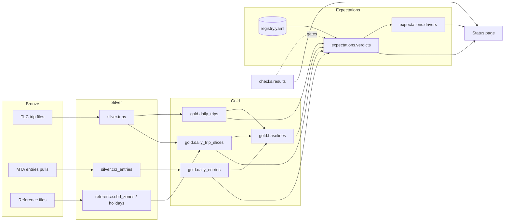

# CRZ Expectations

An expectation-driven data pipeline for New York City's congestion pricing program. It records what a metric is expected to do before the data arrives, then scores the expectation automatically when the data lands and shows where any gap comes from.

**[Status page](https://bobby-101010.github.io/crz-expectations/)** · [Design spec](docs/SPEC.md) · [Decision records](docs/decisions/) · [Data sources](docs/sources.md)

## What it does

Most pipelines move data and check that it arrived intact. This one also holds a registry of written expectations about the world, such as "about 4% fewer vehicles will enter the zone this week than in the matching week last year". Each entry names a metric, a window, a range, a reason, and who said it. Entries can be added but never edited.

When the data for a window is loaded, a scoring job gives each entry a verdict:

| Verdict | Meaning |
| --- | --- |
| held | The observed value fell inside the expected range. |
| violated (low or high) | It fell outside. |
| pending | The data for the window is not published or loaded yet. |
| data issue | A data check on the entry's inputs failed, so the result is not trusted. |
| not scoreable | No data this project holds shares the expectation's baseline. |

For a scored entry, a drivers job splits the gap by slices such as service, operator, or entry point. It shows where the gap sits. It does not say why.

## Results so far

As of November 12, 2026:

- **Scale.** 1,066,504,959 taxi and ride-hail trips from January 2023 to September 2026, and 6,894,288 rows of vehicle entries into the zone from January 2025 to October 2026, in Iceberg tables built with Spark on one laptop.
- **13 expectations:** 5 held, 7 pending, 1 not scoreable. The 7 pending are forecasts for windows whose data is not yet published.
- **The pipeline reproduces a published figure.** Three entries re-derive Table 3-2 of the MTA's First Evaluation Report, on trips that start or end in the zone from January to September 2025 against 2024. All three land within 0.2 points of the report:

  | | MTA, in totals | This pipeline |
  | --- | --- | --- |
  | Yellow and ride-hail | +0.82% | +0.79% |
  | Yellow | +16.87% | +16.71% |
  | Ride-hail | -4.86% | -4.86% |

- **Flat totals hide a large shift in mix.** Trips touching the zone rose 1.7% in tolling's first year. Under that, yellow taxis ran about 4.6 million trips above an even split of the expected change and ride-hail about 3.5 million below.
- **567 data check results** across 45 months, with one warning, explained in [decision 0008](docs/decisions/0008-cbd-zone-membership-by-id.md).

## Architecture



| Layer | Holds | Rule |
| --- | --- | --- |
| Bronze | Source files exactly as received | Never edited or deleted. New pulls are added beside old ones. |
| Silver | One conformed table per source, at source grain | Explicit casts. Rows outside a file's month are dropped and counted. |
| Gold | Daily aggregates and baselines | Derived, and rebuildable at any time. |
| Expectations | Registry, verdicts, drivers | Judges the data and never refines it. The registry is append-only. |
| Checks | Results of data checks | A failing check on an entry's inputs turns its verdict into a data issue. |

The stack is PySpark 4.1.3 and Iceberg 1.12.0 in local mode, in Docker, with Python 3.12 managed by uv. Every job handles one month of one source and overwrites only that month's partitions, so any month can be rerun.

## The approach

- An expectation is written down before its data is available, and the git history shows when.
- A data check is a claim about the data. An expectation is a claim about the world. Scoring waits on the checks.
- Every entry is labeled by origin: official, derived, prospective, or retrospective. Only prospective entries test a forecast.
- A pending verdict is a result. It shows the system waiting for evidence.

In real use the expected ranges would come from subject matter experts. Here they come from an AI agent acting as one, interviewed and checked by the engineer. Every such entry is labeled, and the [full interview](docs/elicitation/2026-11-11-crz-expectations.md) is in the repo.

## Run it

You need Docker Desktop, Git, and Make. Everything else runs in the container.

```bash
make build                                   # build the image
make test                                    # unit tests
make test-integration                        # jobs end to end, with Iceberg, on tiny fixtures
make backfill START=2025-01 END=2025-03      # download TLC files, build silver and gold
make reference                               # zone and holiday reference tables
make entries START=2025-01 END=2025-03       # pull MTA entries, build silver and gold
make gold-backfill START=2025-01 END=2025-03 # trip slices, from silver
make baselines                               # what "normal" looks like, per metric
make checks                                  # data checks over every loaded month
make validate                                # the registry against its model and the catalog
make score                                   # a verdict for every expectation
make drivers                                 # where each gap comes from
make site                                    # export and render the status page
```

Three months of data is enough to try it. The full history is about 25 GB of source files.

## Repository

```text
expectations/registry.yaml     the expectations (append-only)
expectations/metrics.yaml      the metric catalog
src/pipeline/jobs/             one job per step, each a run(spark, ...) plus a thin main()
src/pipeline/checks/           data checks as pure functions
src/pipeline/                  transforms, baselines, scoring, drivers, the registry model
src/pipeline/site/             export and rendering for the status page
tests/                         unit tests, and integration tests under tests/integration/
docs/SPEC.md                   the design spec the project was built from
docs/decisions/                one short record per decision a reviewer could question
docs/elicitation/              the interview that produced the registry
docs/sources.md                every source, with its columns as received and its quirks
site/                          the published status page and its data
```

## Built with Claude Code

The project was finished with [Claude Code](https://claude.com/claude-code), working phase by phase from a written spec. Each phase began with a plan the owner approved, and ended with tests and a pull request the owner merged.

- [docs/SPEC.md](docs/SPEC.md) is the spec, with a change note for every revision.
- [docs/decisions/](docs/decisions/) records each decision, what was found in the data, and the alternatives.
- [docs/elicitation/](docs/elicitation/) is the unedited interview behind the expectations.
- [CLAUDE.md](CLAUDE.md) holds the working rules. One of them: the implementer never writes or changes an expectation's values.

## Data

Trip records are from the NYC Taxi and Limousine Commission. Vehicle entries and the toll zone's taxi zones are from the MTA through NYS Open Data. Details and known quirks are in [docs/sources.md](docs/sources.md). This is a personal project and is not affiliated with either agency.
