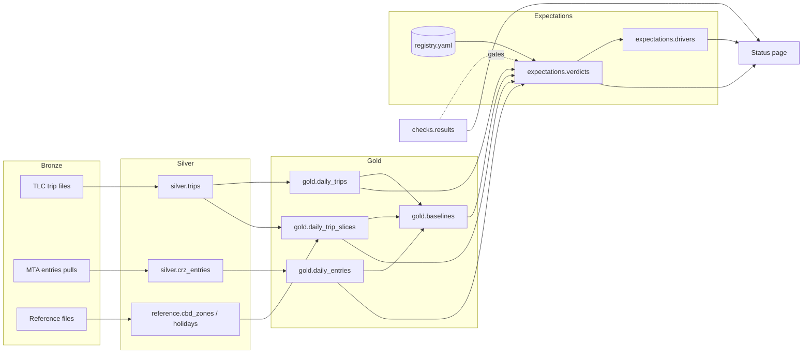

# CRZ Expectations: design spec

Version 1.0, November 11, 2026. Drafted with Claude and approved by the owner.

This spec is the source of truth for finishing the project. Claude Code implements it phase by phase. The owner reviews, decides, and verifies. Changes to the spec are made by editing this file in a commit, with a line in `docs/ai-log.md` saying what changed and why.

## Contents

1. Purpose
2. The idea in brief
3. Where the project stands
4. Target architecture
5. Data sources
6. Data model
7. Components
8. Engineering conventions
9. Working with AI
10. Phase plan
11. Anki cards (final phase)
12. Out of scope
13. Risks and open questions
14. Sources
- Appendix A: `CLAUDE.md`
- Appendix B: AI log template
- Appendix C: Registry example
- Appendix D: Essay outline

---

## 1. Purpose

A public portfolio project for data engineering roles. It has to show three things to a reviewer who spends a few minutes on it:

1. **Engineering depth.** Spark and Iceberg at a scale of about a billion rows, a medallion layout, idempotent jobs, data checks, tests, and CI.
2. **A point of view.** Expectation-driven data engineering: write down what should happen before the data arrives, then build pipelines that measure the gap and locate where it comes from.
3. **Disciplined use of generative AI.** The project is finished with Claude Code, working from this spec, with a public log of what the AI did, what the owner decided, and what was checked.

The deadline is about two weeks from the date above. Every phase has a "done when" list, so scope can be cut cleanly if time runs short.

## 2. The idea in brief

**Expectation.** A written, versioned statement of what a metric should do: which metric, over which window, compared with what, by how much, why, who said so, and when it was recorded. Expectations are data, kept in `expectations/registry.yaml`, and once recorded they never change.

**Baseline.** What "normal" looks like for a metric, computed from history.

**Verdict.** The result of scoring an expectation: held, violated low, violated high, pending, data issue, or not scoreable.

**Driver.** The slices of data (a service, an operator, a vehicle class, an hour) that account for the gap between observed and expected. A driver shows where the gap comes from. It does not say why, and the project never calls it a cause.

**Data check versus expectation.** A data check is a claim about the data, such as "this column is never null". An expectation is a claim about the world, such as "trips touching the zone fall after tolling starts". Scoring depends on the checks: if a check on an expectation's inputs fails, the verdict is "data issue", not "violated".

**Origin.** Every expectation records where it came from:

- `official`: published by an agency before the outcome.
- `derived`: the owner's translation of an official expectation onto a metric this project can measure.
- `prospective`: written by the owner before the data was available to them. The git commit time is the evidence.
- `retrospective`: written after seeing the data. These are allowed but always labeled, because they show what to watch rather than test a prediction.

## 3. Where the project stands

Checklists 1 and 2 are done. They were planned with Claude in chat. Claude drafted the code, and the owner set it up, ran it, debugged it, and verified it. That history goes in the first AI log entry.

### Stack (pinned; do not upgrade without asking)

| Piece | Version |
| --- | --- |
| Python | 3.12 (image `python:3.12-slim`), managed with uv 0.11.7 and `uv.lock` |
| PySpark | 4.1.3 |
| Iceberg | 1.12.0, runtime `iceberg-spark-runtime-4.1_2.13`, `hadoop` catalog named `local` at `/data/warehouse` |
| Java | the image's `default-jre-headless` |
| Docker | Docker Desktop on an M4 MacBook Air (24 GB, arm64); Compose 5.5.1 |

The project runs in Spark local mode with a 6 GB driver. A two-worker standalone cluster is available under the Compose profile `cluster`, and a history server under the profile `history`.

### Repository today

```text
crz-expectations/
  pyproject.toml, uv.lock, Dockerfile, compose.yaml, Makefile
  .devcontainer/devcontainer.json      dev container on the `spark` service
  src/pipeline/
    session.py                         build_session(): Iceberg catalog, event log, memory
    months.py                          month_bounds(), month_range()
    transforms.py                      conform_trips(), daily_trips(); pure, tested
    jobs/ingest.py                     download one TLC file into bronze
    jobs/silver_trips.py               bronze -> local.silver.trips, one service-month
    jobs/daily_trips.py                silver -> local.gold.daily_trips, one month
    jobs/backfill.py                   loops months x services with one session
    jobs/profile_schema.py             column types per bronze file
  tests/                               8 unit tests (pytest)
  data/                                not in git: bronze/, warehouse/, spark-events/
```

The Make targets are `build`, `test`, `shell`, `download`, `profile`, `silver`, `gold`, `backfill`, `history`, `cluster-up`, `cluster-down`, and `cluster-silver`. Make runs in a Mac terminal, and every target runs inside the image through `docker compose run`.

### Data loaded

Yellow taxi and ride-hail (`fhvhv`) trips for 2023-01 through 2026-08: 44 months and about 1.04 billion silver rows.

| Service | Year | Months | Trips | Fee recorded | Fee trips |
| --- | --- | --- | --- | --- | --- |
| fhvhv | 2023 | 12 | 232,490,020 | 0 | 0 |
| fhvhv | 2024 | 12 | 239,470,448 | 0 | 0 |
| fhvhv | 2025 | 12 | 243,589,684 | 243,589,684 | 82,780,798 |
| fhvhv | 2026 | 8 | 168,186,711 | 168,186,711 | 53,920,147 |
| yellow | 2023 | 12 | 38,309,496 | 0 | 0 |
| yellow | 2024 | 12 | 41,169,300 | 0 | 0 |
| yellow | 2025 | 12 | 48,722,388 | 48,722,388 | 34,904,980 |
| yellow | 2026 | 8 | 29,703,209 | 29,703,209 | 21,314,425 |

These counts are a regression baseline. A refactor that changes them for 2023 through 2025 is a bug until explained.

Two more numbers are known to be right. Gold yellow for 2025-01-04 is 97,804 trips with 401 fee trips. Gold yellow for 2025-01-05 is 79,624 trips with 51,509 fee trips.

### Findings so far

- **The January 4 trace.** An expectation of zero fee trips before launch was violated by 401 trips. Of those, 397 were picked up late on January 4 and dropped off after tolling began at midnight. The data was right and the expectation was at the wrong grain, so silver keeps `dropoff_at`. Four trips remain unexplained and are recorded as a known residual.
- **Unexplained, to be registered as expectations:** yellow trips rose 18.3% from 2024 to 2025 while ride-hail rose 1.7%. About 72% of yellow trips carried the fee in 2025, against 34% of ride-hail trips.

### Known environment quirk

Dev container builds can fail under Buildx 0.37.2 with `additional privileges requested ... --allow=fs.read`. The workaround is to start VS Code with `BUILDX_BAKE_ENTITLEMENTS_FS=0 code .`. Builds from a terminal with `docker compose build` are not affected.

## 4. Target architecture



| Layer | Holds | Rule |
| --- | --- | --- |
| Bronze | Source files exactly as received | Never edited or deleted. New pulls are added beside old ones. |
| Silver | One conformed table per source, at source grain | Explicit casts and mappings. Rows outside a file's period are dropped and counted. |
| Gold | Daily aggregates and baselines | Derived and rebuildable at any time. |
| Expectations | Registry, verdicts, drivers | Judges the data and never refines it. The registry is append-only. |
| Checks | Results of data checks | Gates scoring. |

## 5. Data sources

| Source | Access | Use | Notes |
| --- | --- | --- | --- |
| TLC yellow taxi trips | `https://d37ci6vzurychx.cloudfront.net/trip-data/yellow_tripdata_YYYY-MM.parquet` | silver.trips | Loaded 2023-01 to 2026-08. 2026-09 is now published. |
| TLC high-volume for-hire trips | `.../fhvhv_tripdata_YYYY-MM.parquet` | silver.trips | `hvfhs_license_num` HV0003 is Uber and HV0005 is Lyft. |
| TLC taxi zone lookup | `https://d37ci6vzurychx.cloudfront.net/misc/taxi_zone_lookup.csv` | reference.cbd_zones (names, borough) | |
| MTA Central Business District Taxi Zones | NYS Open Data `yfdc-w5jh` (`https://data.ny.gov/d/yfdc-w5jh`) | reference.cbd_zones (membership) | Polygons of the taxi zones inside the toll zone. Column names are not verified: inspect them first. |
| MTA Congestion Relief Zone Vehicle Entries | NYS Open Data `t6yz-b64h` (`https://data.ny.gov/d/t6yz-b64h`) | silver.crz_entries | See below. |

On the entries dataset, the MTA describes one row as one date, 10-minute interval, time period, vehicle class, and detection group (the first crossing point used to enter the zone). Its fields include toll date, 10-minute interval, time period (peak or overnight), vehicle class, detection group, CRZ entries, and excluded roadway entries. It starts on January 5, 2025, updates weekly, and has no pre-launch baseline. The MTA says it must not be used to estimate toll revenue.

**Phase 2 starts by fetching the real column list** (`https://data.ny.gov/api/views/t6yz-b64h/columns.json`) and recording it in `docs/sources.md`. The names above are paraphrased from the MTA's article and may not match exactly. Pull data through the Socrata API one month at a time, with paging, rather than as one bulk CSV.

**The official projection, verified:** the MTA's Reevaluation 2 (November 2024), Table 2.2, gives a 13.4% daily vehicle reduction for the Phase 1 ($9) toll, relative to the No Action alternative, with 2023 as the analysis year.

**The reported outcome:** the Governor's release of January 5, 2026 reports 27 million fewer vehicles entering the zone in the first year, an 11% reduction. The release does not name its baseline.

The two figures rest on different baselines (a modeled No Action case versus an unstated comparison), so they are not directly comparable. The essay should make that point.

## 6. Data model

All tables live in the Iceberg catalog `local`. Timestamps are New York wall-clock time stored as `TIMESTAMP_NTZ`, and the session time zone is pinned to UTC.

### Existing

| Table | Grain | Partitioned by |
| --- | --- | --- |
| `silver.trips` | trip | `service`, `months(pickup_at)` |
| `gold.daily_trips` | pickup date x service | `months(trip_date)` |

`silver.trips` columns: `service`, `operator_code`, `pickup_at`, `dropoff_at`, `pickup_zone_id`, `dropoff_zone_id`, `trip_miles`, `cbd_congestion_fee`, `source_month`.

### New

**`reference.cbd_zones`** — one row per TLC zone.
`location_id INT, zone STRING, borough STRING, in_cbd BOOLEAN, membership_source STRING, pulled_on DATE`.
Unpartitioned and rebuilt in full on each load.

**`reference.holidays`** — one row per date.
`holiday_date DATE, name STRING`.
Covers 2023 to 2027, from the `holidays` package (US, New York).

**`silver.crz_entries`** — one row per source row.
`toll_date DATE, interval_start TIMESTAMP_NTZ, time_period STRING, vehicle_class STRING, detection_group STRING, detection_region STRING, crz_entries BIGINT, excluded_roadway_entries BIGINT, source_pull_date DATE`.
Partitioned by `months(interval_start)`. Include `detection_region` only if the source has it. Each month is rebuilt from its latest bronze pull.

**`gold.daily_trip_slices`** — one row per pickup date x service x operator x zone relation x pickup hour.
`trip_date DATE, service STRING, operator_code STRING, zone_relation STRING, pickup_hour INT, trips BIGINT, fee_trips BIGINT`.
Partitioned by `months(trip_date)`. `zone_relation` is one of `both_in`, `pickup_in`, `dropoff_in`, or `neither`, from a broadcast join of silver to `reference.cbd_zones`. A trip that only passes through the zone cannot be identified from zones, so it lands in `neither`; fee trips in `neither` estimate that through-traffic.

**`gold.daily_entries`** — one row per date x vehicle class x detection group x time period.
`entry_date DATE, vehicle_class STRING, detection_group STRING, time_period STRING, crz_entries BIGINT, excluded_roadway_entries BIGINT`.
Partitioned by `months(entry_date)`.

**`gold.baselines`** — one row per metric x slice x date.
`metric STRING, slice_key STRING, slice_value STRING, baseline_date DATE, method STRING, p10 DOUBLE, p50 DOUBLE, p90 DOUBLE, n_obs INT`.
Partitioned by `metric`, `months(baseline_date)`. The method is `same_weekday_trailing_8`: the same weekday over the previous 8 weeks, holidays excluded. A slice with fewer than 6 observations gets no row. `slice_key = 'all'` is the unsliced metric.

**`checks.results`** — one row per check execution.
`run_id STRING, checked_at TIMESTAMP, check_id STRING, target_table STRING, partition_value STRING, status STRING, observed DOUBLE, threshold STRING, message STRING`.
`status` is `pass`, `warn`, or `fail`. Append-only.

**`checks.ingest_stats`** — one row per silver load.
`run_id STRING, loaded_at TIMESTAMP, service STRING, source_month STRING, rows_read BIGINT, rows_kept BIGINT`.
The silver job writes it in place of only printing these numbers.

**`expectations.verdicts`** — one row per expectation per scoring run.
`run_id STRING, scored_at TIMESTAMP, registry_commit STRING, expectation_id STRING, window_start DATE, window_end DATE, observed DOUBLE, expected_low DOUBLE, expected_high DOUBLE, unit STRING, verdict STRING, failing_checks ARRAY<STRING>, note STRING`.
Append-only, so the history of verdicts is kept.

**`expectations.drivers`** — one row per expectation x dimension x slice per run.
`run_id STRING, expectation_id STRING, dimension STRING, slice_value STRING, comparison_value DOUBLE, observed_value DOUBLE, expected_value DOUBLE, gap DOUBLE, share_of_gap DOUBLE, gap_rank INT`.

## 7. Components

### 7.1 Data checks (`src/pipeline/checks/`)

A check is a function that takes a Spark session and a scope (table and partition) and returns one or more `CheckResult(check_id, target_table, partition_value, status, observed, threshold, message)`. A runner executes the checks registered for a table and appends the results to `checks.results`.

Initial checks:

| Id | Target | Rule | On breach |
| --- | --- | --- | --- |
| `schema_required_columns` | bronze TLC file | Every required source column exists, matched without regard to case | fail |
| `silver_volume` | silver.trips, service-month | Rows within a band around the trailing 6-month median | warn |
| `dropped_share` | ingest_stats | Rows dropped as out-of-month, as a share of rows read, at or below a threshold | warn |
| `required_nulls` | silver.trips, service-month | Null share of `pickup_at`, `dropoff_at`, and both zone ids at or below a threshold | fail |
| `dropoff_before_pickup` | silver.trips, service-month | Share of trips ending before they start, at or below a threshold | warn |
| `fee_presence` | silver.trips, service-month | Fee is null for every row before 2025-01 and filled for every row from 2025-01 | fail |
| `fee_before_launch` | silver.trips | Fee trips dropped off before 2025-01-05 00:00: at most 10 (four are known) | warn |
| `cbd_zone_membership` | reference.cbd_zones | In 2025, at least 95% of trips that start and end in the same in-zone zone carry the fee | warn |
| `entries_days_complete` | silver.crz_entries, month | Every date in the month up to the latest loaded date has rows | fail |
| `freshness` | each source | Latest month or date loaded versus the latest published | warn |
| `regression_totals` | silver.trips | Totals per service and year for 2023 to 2025 equal the table in section 3 | fail |

**Thresholds** come from the 44 months already loaded, not from guesses. Claude Code computes each metric's historical distribution, proposes a threshold, and records it with its reasoning in `docs/decisions/`. The owner approves before it is used.

### 7.2 New sources and reference data

- `jobs/reference.py` loads the zone lookup and the MTA zone dataset into bronze (dated snapshots), then builds `reference.cbd_zones` and `reference.holidays`.
- `jobs/ingest_entries.py` pulls one month of the entries dataset into `data/bronze/crz_entries/<YYYY-MM>/pulled_<YYYY-MM-DD>.csv`. A month that is still in progress is pulled again later, as a new file.
- `jobs/silver_entries.py` builds one month of `silver.crz_entries` from the latest pull for that month.
- The pure mapping functions go in `transforms.py` (or a new `transforms_entries.py`) and get unit tests on fixture rows, as for trips.

### 7.3 Gold slices and baselines

- `jobs/daily_trip_slices.py` builds one month from silver.trips and `reference.cbd_zones`, using a broadcast join.
- `jobs/daily_entries.py` builds one month from silver.crz_entries.
- `jobs/baselines.py` builds baselines for every metric in the catalog with `baseline: true`, using window functions over gold. Never read silver here.
- `make gold-backfill START= END=` rebuilds gold for a range of months from silver without touching bronze.

### 7.4 Metric catalog (`expectations/metrics.yaml`)

A metric definition is a small semantic layer: a name, a source gold table, a value column, filters, the dimensions it can be sliced by, the date column, and a kind.

- `sum` metrics add up a column.
- `ratio` metrics divide one sum metric by another.

Initial metrics:

| Metric | Source | Value | Filter | Dimensions |
| --- | --- | --- | --- | --- |
| `tlc_trips` | gold.daily_trip_slices | trips | | service, operator_code, zone_relation, pickup_hour |
| `tlc_cbd_touch_trips` | gold.daily_trip_slices | trips | `zone_relation != 'neither'` | service, operator_code, zone_relation, pickup_hour |
| `tlc_fee_trips` | gold.daily_trip_slices | fee_trips | | service, operator_code, zone_relation, pickup_hour |
| `crz_entries` | gold.daily_entries | crz_entries | | vehicle_class, detection_group, time_period |
| `excluded_roadway_entries` | gold.daily_entries | excluded_roadway_entries | | vehicle_class, detection_group, time_period |
| `fhvhv_per_yellow` | ratio | `tlc_trips[service=fhvhv]` / `tlc_trips[service=yellow]` | | |

Metrics marked `baseline: true` get baselines. Start with `tlc_trips`, `tlc_cbd_touch_trips`, and `crz_entries`.

Metric code lives in `src/pipeline/metrics.py`: `load_catalog()`, `daily_series(spark, metric, start, end, by=None)`. A unit test checks that every metric in the catalog resolves.

### 7.5 Expectation registry (`expectations/registry.yaml`)

Entries are validated by a pydantic model in `src/pipeline/registry.py`.

| Field | Required | Meaning |
| --- | --- | --- |
| `id` | yes | Stable kebab-case id, never reused |
| `statement` | yes | One sentence a non-engineer can read |
| `origin` | yes | `official`, `derived`, `prospective`, or `retrospective` |
| `author` | yes | Who wrote the expected values. Always `human` in this project. |
| `recorded` | yes | Date the expectation was written |
| `metric` | unless not measurable | A catalog metric name, with optional `filters` |
| `comparison` | unless not measurable | `change_vs_period`, `within_baseline`, or `value_range` (7.6) |
| `window` | yes | `start` and `end` dates, inclusive |
| `comparison_window` | for `change_vs_period` | Defaults to `window` shifted back 364 days, which keeps weekdays aligned |
| `expected` | unless not measurable | `low` and `high`, in the comparison's unit |
| `measurable` | no, default true | `false` with a `not_measurable_reason` |
| `drivers` | no | Dimensions to break a gap down by |
| `rationale` | yes | Why this range, in the owner's words |
| `sources` | for official and derived | Links |
| `reported_outcome` | no | A figure someone else published, with its source, for context only |
| `supersedes` | no | The id of an earlier entry this one revises |

Rules:

- **Append-only.** Once an entry is on `main`, its `metric`, `filters`, `comparison`, `window`, `comparison_window`, `expected`, and `recorded` never change. A revision is a new entry with `supersedes`. A CI step compares the PR's registry with `origin/main` and fails on any such change.
- **Values are the owner's.** Claude Code never writes `expected`, `rationale`, or `statement` values. It may add an entry skeleton with `TODO(human)` in those fields. Validation fails on `main` if any `TODO(human)` remains.
- **Seed entries** (Appendix C has the YAML):
  - `official-entries-phase1`: the 13.4% projection. Not measurable, because the entries data starts at launch and No Action is a modeled counterfactual. `reported_outcome` is the 11%.
  - `derived-cbd-touch-2025`: trips touching the zone, first 52 weeks of tolling versus the same weeks a year earlier.
  - `retrospective-fhvhv-per-yellow`: the ride-hail to yellow ratio, labeled retrospective because the 2025 shift was seen first.
  - At least two `prospective-*` entries, written and pushed on day 1 (section 10, Phase 0). Candidates are the next weekly MTA entries update, and TLC October 2026, which publishes about two months after the month ends, so after the deadline. A pending verdict on the status page is a feature: it shows the system waiting for evidence.

### 7.6 Scoring (`jobs/score.py`)

For each registry entry, scoring computes `observed` in the comparison's unit and assigns a verdict.

| Comparison | Observed | Unit |
| --- | --- | --- |
| `change_vs_period` | `100 * (sum over window / sum over comparison window - 1)` | percent |
| `within_baseline` | Share of days in the window whose daily value lies within that day's p10 to p90 baseline | percent of days |
| `value_range` | Daily mean of the metric over the window (for ratios, the ratio of the window sums) | metric units |

Verdicts, in order of precedence:

1. `not_scoreable` if `measurable: false`.
2. `pending` if the window ends after the latest loaded date for the metric's source.
3. `data_issue` if any `fail` result in `checks.results`, from the latest run for each check, overlaps the window or comparison window on the metric's source tables. List those check ids in `failing_checks`.
4. `held` if `low <= observed <= high`.
5. `violated_low` or `violated_high` otherwise.

The registry commit comes from the host, through the Makefile: `-e REGISTRY_COMMIT=$$(git rev-parse --short HEAD)`. Record it, suffixed `-dirty` if the tree has uncommitted changes. Git inside the container is avoided because of ownership checks on the mounted repo.

### 7.7 Drivers (`jobs/drivers.py`)

Drivers are computed for `change_vs_period` verdicts that are `held`, `violated_low`, or `violated_high`, for each dimension in the entry's `drivers` list. The method is additive, so the slice gaps sum exactly to the total gap:

- `m` is the expected change, the midpoint of `low` and `high`, as a fraction.
- For each slice `s`: `expected_s = comparison_s * (1 + m)` and `gap_s = observed_s - expected_s`.
- The total gap is the sum of `gap_s`, which equals `observed_total - comparison_total * (1 + m)`.
- `share_of_gap = gap_s / total gap`. Rank slices by the absolute size of `gap_s`.

The assumption that every slice was expected to move by the same percentage is stated on the status page. Drivers are always labeled "where the gap comes from", never "why". Other comparison types show "drivers not supported for this comparison".

### 7.8 Status page (`site/`)

A static site on GitHub Pages, deployed by a workflow when `site/**` changes on `main`. No front-end framework.

- `make site` exports small JSON to `site/data/`: verdicts, drivers, latest checks, freshness, and a daily series for each expectation's metric. It then renders `site/index.html` with Jinja2 and draws small charts as inline SVG generated in Python. `site/` is committed.
- For each expectation, the page shows: the statement, an origin badge, the recorded date linked to the registry commit, the verdict badge, observed versus the expected range drawn as a bar, the top three drivers with their share of the gap, and the note.
- The page also shows: a data health table (the latest result of each check), freshness per source, a short "how to read this" section, and links to the README, the essay, this spec, and the AI log.
- It must work at phone width, respect dark mode, and pass basic accessibility checks (labels, contrast, alt text for charts).

GitHub Pages on a free plan needs a public repo. Making the repo public is the owner's decision in Phase 5. Check the history for secrets first.

### 7.9 Orchestration (optional, Phase 6)

Do this only if Phases 0 through 5 are done by about day 11.

- Airflow, latest stable 3.x, in standalone mode under a Compose profile `airflow`. Airflow gets its own virtual environment inside an image built from the project image, so its dependencies never touch `/opt/venv`.
- A DAG named `crz_monthly`, one run per month. Tasks call the existing jobs with `/opt/venv/bin/python -m ...` through `BashOperator`, in this order: ingest for each service, silver for each service, checks, gold, slices, baselines, score, drivers, site export.
- Done when: a run for one month reproduces what `make` produces for that month, and a missed month is caught up by the scheduler.

If Phase 6 is skipped, the README says orchestration is Make plus idempotent monthly jobs, and that the jobs are already shaped as `run(spark, month)` functions ready for an orchestrator.

### 7.10 Continuous integration (`.github/workflows/`)

- `ci.yml`, on every push and pull request:
  - `ruff check` and `ruff format --check`
  - Registry and metric catalog validation
  - The append-only registry check, on pull requests
  - Unit tests
  - Integration tests marked `@pytest.mark.integration`: they run real jobs end to end on tiny fixture Parquet files with Iceberg in a temporary warehouse, which covers the DDL that was never tested before
  - Setup: Python 3.12 with `astral-sh/setup-uv`, Java 21 with `actions/setup-java`, and `IVY_DIR`, `WAREHOUSE_DIR`, and `SPARK_EVENTS_DIR` pointed at temporary folders, `SPARK_DRIVER_MEMORY=2g`, and the Ivy cache cached between runs
- `pages.yml`: deploys `site/` to Pages.

## 8. Engineering conventions

- **Jobs** have a pure `run(spark, ...)` and a thin `main()`. Logic lives in pure DataFrame functions with unit tests.
- **Unit of work.** One month of one source. Every write is idempotent through `overwritePartitions()`, except the append-only tables.
- **Read one bronze file at a time.** Cast every column explicitly. Fail loudly when a required column is missing.
- **Filter on raw columns** (`pickup_at`), not on expressions of them, so filters push down to Iceberg.
- **Never read silver** where gold has the data. The billion-row table is read only to build gold.
- **Bronze is never edited or deleted.** Gold may be dropped and rebuilt, but ask the owner first.
- **Any run likely to take more than 10 minutes needs the owner's approval** first: a full backfill, `gold-backfill` over all months, or anything that scans all of silver. Develop against one to three months.
- **Dependencies** are added with `uv add`. Expected additions: `pyyaml`, `pydantic`, `jinja2`, and `holidays`, with `ruff` as a dev dependency.
- **Every decision a reviewer could question** gets a short record in `docs/decisions/NNNN-title.md`: context, decision, alternatives. Backfill records for these past decisions: Spark local mode with Iceberg on the `hadoop` catalog; medallion layers plus a separate expectations layer; reading one file at a time; null versus zero for the fee; `TIMESTAMP_NTZ`; rebuilding gold rather than migrating.
- `docs/sources.md` lists every source with its URL, its columns as actually received, quirks found, and terms of use.

## 9. Working with AI

This section is part of what the project demonstrates. Follow it as closely as the code conventions.

### Division of labor

| The owner | Claude Code |
| --- | --- |
| Writes every expected value, rationale, and statement in the registry | Builds the machinery that stores, validates, and scores them |
| Approves each phase plan before work starts | Proposes the plan in plan mode, with files, tests, and acceptance steps |
| Approves thresholds, destructive actions, and long runs | Computes threshold candidates from data and explains them |
| Writes the essay prose | May outline and fact-check the essay against data and sources, but never drafts its prose |
| Runs and records acceptance checks, and decides what is done | Runs fast checks and tests, and reports results honestly, including failures |
| Merges pull requests | Opens one branch and one pull request per phase |

### Per-phase workflow

1. Claude Code reads this spec's section for the phase and proposes a plan in plan mode.
2. The owner approves or edits the plan.
3. Claude Code works on branch `phase-N-short-name`, with tests written alongside the code.
4. Claude Code runs unit tests, integration tests, and the phase's fast acceptance commands, and reports the results.
5. The owner runs the remaining acceptance steps and fills in the observed results.
6. Claude Code drafts the phase's AI log entry from the session. The owner completes the "checked", "changed or rejected", and "mistakes caught" parts in their own words.
7. A pull request opens with a summary and the acceptance results, and the owner merges it.

### AI log (`docs/ai-log.md`)

The log is public and honest. It records what was asked, what the AI produced, what was verified and how, what the owner changed or rejected, and the mistakes caught, whether the AI's or the owner's. It never pads or flatters. The template is in Appendix B.

The first entry covers checklists 1 and 2. Claude in chat planned them and drafted the code. The owner set up, ran, debugged, and verified everything, including:

- diagnosing the Buildx 0.37.2 dev container failure from the log;
- tracing the January 4 deviation, which led to a modeling change;
- the full backfill and the four end-of-checklist expectations.

### `CLAUDE.md`

Phase 0 creates `CLAUDE.md` from Appendix A. It is kept short and points to this spec for everything else.

## 10. Phase plan

The days are targets for a two-week window. If a phase runs long, cut its optional items before cutting a later phase.

### Phase 0: Workflow, CI, and day-1 expectations (day 1)

**Do:**
- Create `CLAUDE.md` (Appendix A), `docs/ai-log.md` with its first entry, `docs/decisions/` with the backfilled records, and `docs/sources.md`.
- Add ruff and fix the lint findings.
- Add `ci.yml` with unit tests, plus one integration test that runs the silver and gold jobs on fixtures with Iceberg.

**The owner does first, before anything else:** write the prospective expectations as plain YAML in `expectations/registry.yaml`, with at least `id`, `statement`, `origin`, `author`, `recorded`, `metric`, `comparison`, `window`, `expected`, and `rationale`, using the metric names in 7.4. Commit and push them. Phase 3 may add fields but never changes those values.

Check the entries dataset's latest date that morning. One workable choice is `crz_entries` for a week not yet published, compared with the same week of 2025 (`change_vs_period`).

**Done when:**
- [ ] CI is green on `main`
- [ ] The integration test creates and writes both Iceberg tables in a temporary warehouse
- [ ] The prospective expectations are on `main`, with commit times earlier than their data
- [ ] The first AI log entry is complete

### Phase 1: Data checks (days 2 and 3)

**Do:**
- Build the check framework, `checks.results`, and `checks.ingest_stats`. The silver job writes ingest stats.
- Implement all checks in 7.1 except the two for the entries dataset and `cbd_zone_membership`, which come in Phase 2.
- Propose thresholds from history in a decision record.
- Add `make checks` (all) and `make checks MONTH=`.

**Done when:**
- [ ] The checks run over all 44 months and the results are in `checks.results`
- [ ] `regression_totals` passes
- [ ] Every warn and fail result is explained in the AI log's observed table
- [ ] Each check has a unit test on fixture data

### Phase 2: New sources, slices, and baselines (days 3 to 5)

**Do:**
- Record the real columns in `docs/sources.md`.
- Build `reference.cbd_zones` and `reference.holidays`.
- Ingest the entries dataset from January 2025 to its latest date, and build silver and gold for it.
- Build `gold.daily_trip_slices` for all 44 months. This is a long run, so get approval first.
- Build `gold.baselines`.
- Add the remaining checks.

**Done when:**
- [ ] `cbd_zone_membership` passes, or its result is explained
- [ ] `entries_days_complete` passes
- [ ] The slice totals per day equal `gold.daily_trips` for every day
- [ ] Baselines exist for every catalog metric marked `baseline: true`
- [ ] TLC 2026-09 is loaded through the normal backfill

### Phase 3: Registry and scoring (days 5 to 7)

**Do:**
- Write the metric catalog, the registry model and validation, the append-only CI check, and the scoring job.
- Add the seed entries from Appendix C. The owner fills every `TODO(human)`.

**Done when:**
- [ ] Every entry gets a verdict
- [ ] There is at least one each of `held` or violated, `pending`, and `not_scoreable`
- [ ] A fixture test forces a `data_issue` verdict
- [ ] CI rejects a PR that edits an existing entry's `expected`

### Phase 4: Drivers (days 7 and 8)

**Do:** build the driver job and its unit tests, including one that checks the slice gaps sum to the total gap within floating-point tolerance.

**Done when:**
- [ ] Each scored `change_vs_period` entry has drivers for each listed dimension
- [ ] The owner has read the top drivers and written, in the AI log, which are plausible and which need a closer look

### Phase 5: Status page, README, essay (days 8 to 10)

**Do:**
- Build the `make site` export and renderer, and `pages.yml`.
- Rewrite the README: the pitch, the architecture diagram, headline results, how to run, the philosophy, a link to the essay, and a "Built with Claude Code" section linking the AI log.
- Produce an essay outline (Appendix D) with a fact-checked numbers table. The owner writes `docs/essay.md`.

**Done when:**
- [ ] The page is live
- [ ] It renders at phone width
- [ ] A reader who knows nothing about the project can say from the page alone what each verdict means
- [ ] The owner has made the repo public after checking it for secrets

### Phase 6: Airflow (optional, days 11 to 13)

See 7.9. Skip it if time is short, and update the README instead.

### Phase 7: Anki cards and retrospective (last 1 to 2 days)

See section 11. Also add a final AI log entry: a retrospective on what worked, what didn't, and what the owner would do differently.

## 11. Anki cards (final phase)

Cards are written once, at the end, into the owner's existing ledger. **The ledger is outside the repo and must never be committed to it.**

- **Ledger:** `~/Documents/Anki/crz-anki-cards.md`. Its format is in the file's own header and must be followed exactly. The existing ids are `F-01` to `F-10`, `C1-…`, and `C2-…`, and are never reused.
- **Append one section per topic**, each with its own `**Deck:**` line:

| Section | Deck | Id prefix |
| --- | --- | --- |
| Data checks | `Data Engineering::CRZ Project::Data checks` | `DC-` |
| Sources, slices, and baselines | `...::Baselines` | `BL-` |
| Registry and scoring | `...::Expectations` | `EX-` |
| Drivers | `...::Drivers` | `DR-` |
| Status page and CI | `...::Publishing` | `PB-` |
| Airflow, if built | `...::Orchestration` | `AF-` |
| Building with AI | `...::Building with AI` | `AI-` |

- **Kinds**, as tags: `interview` (questions answerable from this project, with the back as cue bullets of six at most), `pattern` (code to recall), and `concept` (definitions). Each card covers one idea. Every fact must come from the repo, the AI log, the data, or a cited source. Do not invent experiences.
- **The Building with AI section** comes only from `docs/ai-log.md`. It includes interview cards such as:
  - How did you use AI to build this?
  - How did you verify AI-written code?
  - Give an example of an AI mistake you caught.
  - What did you refuse to delegate, and why?
  - How did you structure the spec and `CLAUDE.md`?
  - How did you keep context across sessions?

  It also includes concept and pattern cards for the workflow itself: spec-driven development, plan mode, the append-only registry, and acceptance criteria per phase.
- **Fix card `F-06` in place**, keeping its id. Replace its back with this:

  - Projected: a 13.4% daily vehicle reduction for the $9 Phase 1 toll, relative to the No Action alternative (MTA Reevaluation 2, November 2024, Table 2.2, 2023 analysis year).
  - Reported: 27 million fewer vehicles in year one, an 11% reduction (Governor's release, January 5, 2026, which does not name its baseline).
  - The baselines differ, so the two figures are not directly comparable.

- **Validate** before telling the owner it is done:
  1. `cd ~/Documents/Anki && uv run python -c "from pathlib import Path; from ledger_anki.ledger import parse_ledger, check_unique; c = parse_ledger(Path('crz-anki-cards.md')); check_unique(c); print(len(c), 'cards')"`
  2. With Anki open, the owner runs `uv run ledger-anki --dry-run crz-anki-cards.md`.

  The Anki folder is its own git repo, and the owner commits there.

## 12. Out of scope

- An LLM feature inside the pipeline, such as generated narratives of verdicts. It is easy to make look good and hard to make reliable, and this project's credibility rests on its numbers.
- A second industry dataset (health care or finance). That is the next project, reusing the registry and scoring code.
- Traffic speeds, vehicle miles traveled, and bus speeds datasets.
- A hosted server. The pipeline runs on the laptop, and only the static page is public.

## 13. Risks and open questions

| Risk | Mitigation |
| --- | --- |
| The entries dataset's column names or API limits differ from what is described here | Phase 2 starts by recording the real schema. Pull month by month, with paging. |
| The MTA zone dataset has polygons but no TLC zone ids | Match on zone names with the TLC lookup, and confirm with `cbd_zone_membership`. Otherwise spatially join the TLC shapefile (`https://d37ci6vzurychx.cloudfront.net/misc/taxi_zones.zip`). Record the choice. |
| Full-history runs take hours on a fanless laptop | Get approval first. Run overnight on power. Build gold from silver only once. |
| Iceberg DDL with `TIMESTAMP_NTZ` behaves differently in CI | The Phase 0 integration test catches it early |
| Two weeks is tight | Phases have clear cut lines. Phase 6 is optional. Phase 4's driver method is deliberately simple. |
| The AI writes expectation values or essay prose | Forbidden by `CLAUDE.md`, and `TODO(human)` validation blocks unfinished entries |

Open question for the owner: is a weekly MTA update between day 1 and the deadline enough to score at least one prospective expectation? Check the dataset's latest date on day 1 and choose windows to match.

## 14. Sources

- [TLC trip record data](https://www.nyc.gov/site/tlc/about/tlc-trip-record-data.page)
- [TLC data dictionary, high-volume for-hire trips](https://www.nyc.gov/assets/tlc/downloads/pdf/data_dictionary_trip_records_hvfhs.pdf)
- [MTA Congestion Relief Zone Vehicle Entries, NYS Open Data t6yz-b64h](https://data.ny.gov/d/t6yz-b64h)
- [MTA Central Business District Taxi Zones, NYS Open Data yfdc-w5jh](https://data.ny.gov/d/yfdc-w5jh)
- [MTA article describing the entries dataset](https://mta.info/article/most-detailed-view-of-nyc-traffic-so-far)
- [CBD Tolling Program Reevaluation 2, November 2024](https://www.mta.info/document/158191)
- [Governor's release, January 5, 2026](https://www.governor.ny.gov/news/less-traffic-better-transit-its-first-anniversary-governor-hochul-celebrates-transformational)

---

## Appendix A: `CLAUDE.md`

````markdown
# CRZ Expectations

Expectation-driven data pipeline on NYC congestion pricing data: Spark 4.1 + Iceberg, local on a Mac, run through Docker. The design spec is `docs/SPEC.md`; read the section for the current phase before planning. The spec wins over anything else.

## Commands (Mac terminal, repo root; Docker Desktop must be running)

- `make test`: unit tests in the container. `make lint`: ruff.
- `make silver|gold SERVICE= MONTH=`, `make backfill START= END=`, `make gold-backfill START= END=`
- `make checks [MONTH=]`, `make score`, `make drivers`, `make site` (added as their phases land)
- Develop on 1 to 3 months. Ask before any run likely to take more than 10 minutes.

## Rules

- Never edit or delete files under `data/bronze/`. Ask before dropping any table.
- Pinned versions (PySpark 4.1.3, Iceberg 1.12.0 for Spark 4.1/Scala 2.13, uv 0.11.7, Python 3.12): never change without asking.
- Jobs are `run(spark, ...)` + `main()`; logic in pure, unit-tested DataFrame functions; one month of one source per unit of work; idempotent writes.
- Read bronze one file at a time; explicit casts; fail loudly on missing required columns.
- Never write `expected`, `rationale` or `statement` values in `expectations/registry.yaml`; use `TODO(human)`. Never change an existing entry's recorded values.
- Never write essay prose (`docs/essay.md`). Outlines and fact checks are fine.
- Never commit `~/Documents/Anki/` content to this repo.
- One branch and PR per phase (`phase-N-name`). Plan first, in plan mode, and wait for approval.
- Report test and run results exactly, including failures. Do not say something works unless you ran it.
- At the end of each phase, draft the entry in `docs/ai-log.md` (template in the spec, Appendix B) and leave the owner's sections for the owner.
````

## Appendix B: AI log template

```markdown
## Phase N: <name> (<start date> to <end date>)

**Goal:** one sentence from the spec.

**What I asked Claude Code to do:** the key prompts, summarized, and the plan it proposed.

**What Claude Code produced:** files, tests, and jobs, with the branch and PR link.

**What I checked, and how:** commands run, numbers compared, files read. (owner)

**What I changed or rejected, and why:** (owner)

**Mistakes caught:** by whom, how they were found, and what fixed them. Include mine. (owner)

**Observed results:**

| Step | Result | Expected | Notes |
| --- | --- | --- | --- |

**Time:** about how long the owner spent, and how long the AI worked unattended.
```

## Appendix C: Registry example

Values marked `TODO(human)` are the owner's to write. The official entry's figures are verified (section 5).

```yaml
- id: official-entries-phase1
  statement: The $9 Phase 1 toll reduces daily vehicles entering the Manhattan CBD by 13.4% relative to No Action.
  origin: official
  author: human
  recorded: TODO(human)   # the document's publication date, November 2024
  window: {start: 2025-01-05, end: 2026-01-04}
  measurable: false
  not_measurable_reason: >-
    The public entries data begins at launch, and No Action is a modeled
    counterfactual for a 2023 analysis year, so no observed series in this
    project matches the projection's baseline.
  rationale: Recorded as the program's own stated expectation, for comparison with derived entries.
  sources:
    - https://www.mta.info/document/158191   # Reevaluation 2, Table 2.2
  reported_outcome:
    value: -11
    unit: percent
    note: 27 million fewer vehicles in year one; the release does not name its baseline.
    source: https://www.governor.ny.gov/news/less-traffic-better-transit-its-first-anniversary-governor-hochul-celebrates-transformational

- id: derived-cbd-touch-2025
  statement: TODO(human)
  origin: derived
  author: human
  recorded: TODO(human)
  metric: tlc_cbd_touch_trips
  comparison: change_vs_period
  window: {start: 2025-01-05, end: 2026-01-03}   # 52 weeks; comparison defaults to 364 days earlier
  expected: {low: TODO(human), high: TODO(human)}
  drivers: [service, operator_code, zone_relation, pickup_hour]
  rationale: TODO(human)
  sources:
    - https://www.mta.info/document/158191

- id: retrospective-fhvhv-per-yellow
  statement: TODO(human)
  origin: retrospective
  author: human
  recorded: TODO(human)
  metric: fhvhv_per_yellow
  comparison: value_range
  window: {start: 2026-01-01, end: 2026-09-30}
  expected: {low: TODO(human), high: TODO(human)}
  rationale: TODO(human)   # note that the 2025 drop from 5.8 to 5.0 was seen before writing this
```

## Appendix D: Essay outline

Working title: "Write it down first: expectation-driven data engineering". The owner writes it. Claude Code may only check the facts and numbers.

1. **Hook.** Football's analytics revolution began with counting situations before making decisions.
2. **The problem.** "Data-driven" without stated expectations means looking at charts after the fact.
3. **The idea.** Expectations recorded before outcomes, as versioned data in the pipeline. Name it, and why not "priors".
4. **Expectations about the world versus checks on the data.** Why scoring waits on checks.
5. **Grain, through the January 4 trace.** The expectation decides what the data model must keep.
6. **Baselines and comparability.** 13.4% against a modeled No Action case versus 11% against an unstated baseline. Two true numbers that can't be compared directly.
7. **Drivers, not causes.** Locating a gap is engineering. Explaining it needs more.
8. **Honest labels.** Official, derived, prospective, and retrospective expectations, and why a "pending" verdict is a feature.
9. **What it costs and where it breaks.**
10. **How this transfers** to other domains, such as health care or finance.
